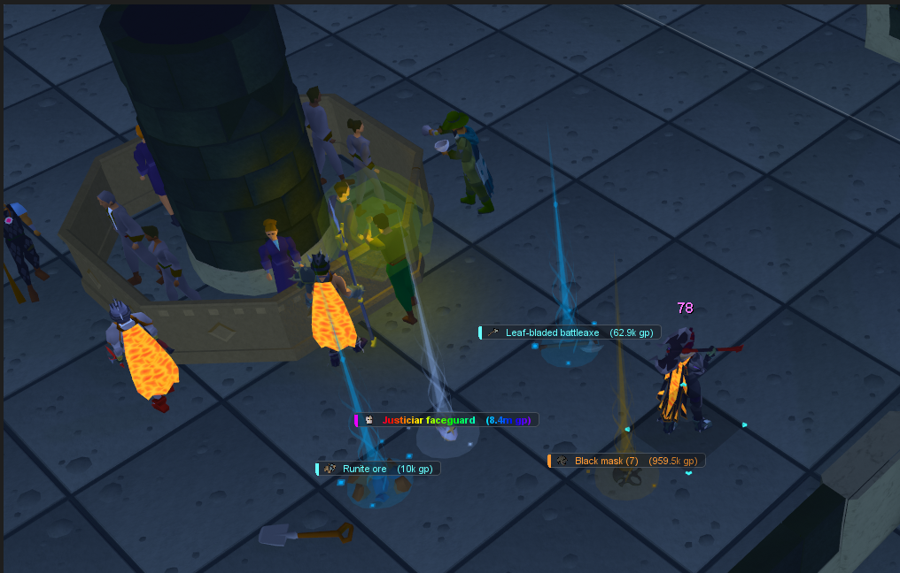
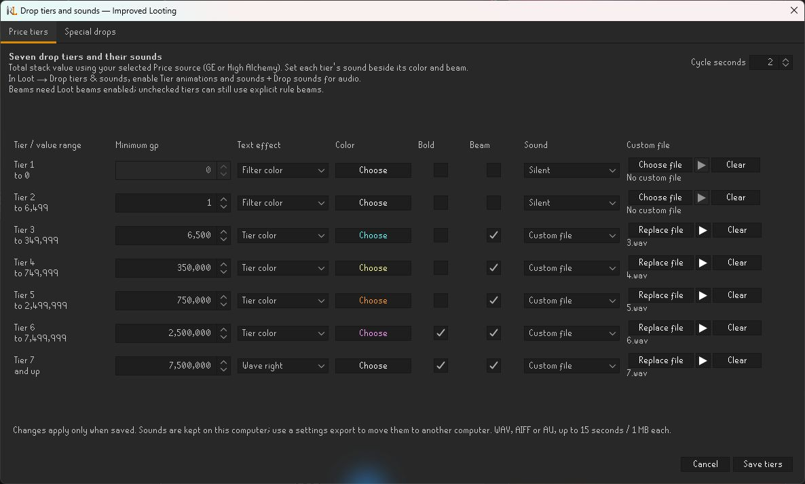
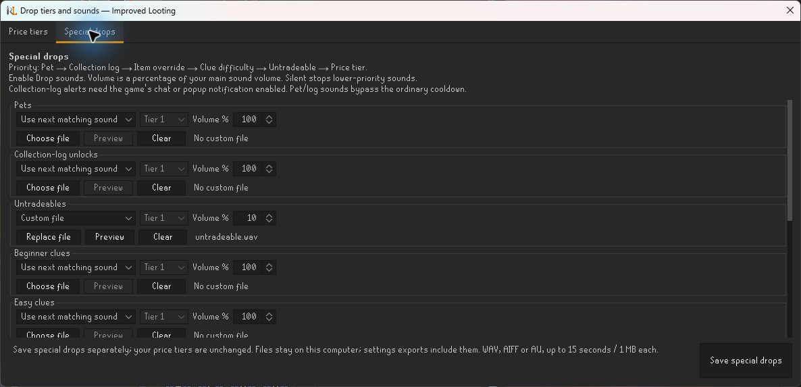

# Improved Looting

Make ground loot easier to scan with compact cards or classic labels, seven editable value tiers, beams and custom sounds. Choose **Grand Exchange or High Alchemy** values and give special drops their own alerts.

**Beta:** display and rule tools are still being refined.

Example Cards styling with custom tier colors and beams. Values and appearance reflect the setup used for this capture.

## What you can do

- **Choose Cards or Labels**, Native or OSRS card styling, item pictures, text, colors and optional backgrounds.
- **Set seven value tiers** with independent thresholds, colors, bold text, beams and sound choices.
- **Recognize special drops** with separate sounds for untradeables, clue difficulties, collection-log unlocks, pets and exact items.
- **Browse nearby loot** as a list or grid, including hidden items, and inspect why a rule matched.
- **Control visibility and ordering** with ownership filters, minimum values, manual item choices, grouping and menu rules.
- **Watch despawn timing** with text, fading pictures or a draining card accent, plus optional alerts.
- **Back up a complete setup**, including supported custom sound and image assets.

## Getting started

1. Install **Improved Looting** from RuneLite’s Plugin Hub and open the chest side panel.
2. In **Loot**, enable **Show ground labels** and choose **CARDS** or **LABELS**.
3. Open **Loot → Drop tiers & sounds → Price source** and choose **Grand Exchange** or **High Alchemy**.
4. Open **Edit tiers and sounds**, adjust the tiers and click **Save tiers**.
5. For price-tier audio, enable **Tier animations and sounds** and **Drop sounds**, then set volume and cooldown. Beams also need **Loot beams** and the tier’s Beam checkbox.

Disable an overlapping Ground Items or Loot Filters display if it produces duplicate labels. The nearby browser can still be used while Improved Looting’s ground display is off.

## GE or High Alchemy values

**Price source** controls built-in tier colors, beams and sounds, displayed values, value limits and loot ordering. GE is the default; select HA for an alchemy-based setup. Coins and platinum tokens retain face value.

An imported or advanced rule with an explicit GE/HA predicate keeps that predicate’s meaning. Changing the display’s price source does not rewrite your filter.

Price-tier editor with saved sound filenames

Example settings showing all seven tiers. Custom sounds are selected by the user, not bundled examples.

## Special-drop sounds

Open **Loot → Drop tiers & sounds → Edit tiers and sounds → Special drops**. Configure pets, collection-log unlocks, untradeables, Beginner/Easy/Medium/Hard/Elite/Master clues and exact item-name overrides. Click **Save special drops** separately from **Save tiers**.

Sound priority is:

**Pet → Collection log → Item override → Clue difficulty → Untradeable → Price tier**

Each match can use a custom file, an existing tier sound, **Silent**, or **Use next matching sound**. Silent stops lower-priority sounds; Use next matching sound continues down the list. References to a tier follow its latest saved sound. Special-row volume is a percentage of the main sound volume.

Enable the game’s collection-log chat or popup notification for collection-log alerts. Related award and ground-drop events are combined to choose the matching priority. Pet and collection-log alerts bypass the ordinary cooldown. Logging in, banking items or bringing out an existing pet does not create a new award.

## Saving sounds and moving profiles

Imported sounds are copied into the plugin’s local storage when saved. Moving or deleting the original file does not remove the stored copy. Missing files are reported without clearing their assignments.

To transfer a complete setup:

1. In the source profile, use **Tools → Settings → Export settings** and save a new backup file.
2. In the destination profile or computer, use **Tools → Settings → Import settings**.
3. Review the summary and select **Apply reviewed setup**. **Undo last change** can restore the previous setup when applicable.

Full exports include supported sound/image assets, tiers, rules, overrides and settings. RuneLite cloud profile sync alone does not transfer the local media files. Audio imports support WAV, AIFF and AU, up to **15 seconds / 1 MB per file**.

## Visibility and compatibility

Hold **Alt** to reveal hidden labels. Alt-click toggles an item’s saved label visibility without picking it up. Ordinary clicks keep their normal game behavior. Ownership filtering also applies to sounds and alerts.

**Connect menu icons** supplies resolved icons and presentation to a compatible Improved Right-Clicks version. The separate Loot Filters provider integration remains dependent on its own upstream update.

Unknown expiry and source information stays unknown. Monster-source filtering does not infer a source from the nearest monster. See the [full guide](docs/guide.md) for grouping, display limits, rule syntax, clue options, priorities and menu behavior.

## Support and attribution

[Report a problem or suggest a feature](https://github.com/wukuna/improved-looting/issues). Include the item, selected price source, relevant rule/settings and a screenshot or small example filter.

See [LICENSE](LICENSE). Adapted parser code retains its BSD 2-Clause attribution and bundled resource notices.
